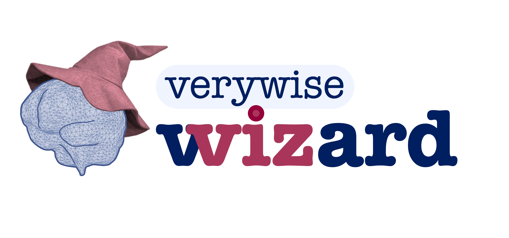
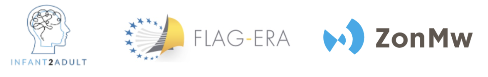

Interactive application for visualizing whole-brain surface vertex-wise statistical maps.
The app generates **3D brain surface maps** based on a given results directory. 
The results directory should contain the output generated using [`verywise`](https://seredef.github.io/verywise/index.html) (or `QDECR`).

You can try the application online [here](https://seredef-verywise-wizard.share.connect.posit.cloud/).

### Running the application locally 
The 3D brain surface reconstructions (especially the high-resolution ones) may be faster to generate on your local machine. 
To run the application locally, clone the repository and then follow either option below.
The app needs Python 3.11 or 3.12.
```
git clone https://github.com/SereDef/verywise-wizard
cd verywise-wizard
```

<details open>
<summary><b>Using <code>uv</code> (recommended)</b></summary>

[`uv`](https://docs.astral.sh/uv/) installs the right Python version and all dependencies for you:
```
uv sync

uv run shiny run --launch-browser app.py
```
</details>

<details>
<summary><b>Using <code>pip</code></b></summary>

> `requirements.txt` is generated from `pyproject.toml`, so it pins the same versions:
```
pip install -r requirements.txt

shiny run --launch-browser app.py
```
</details>

### Make your own wizard

You can turn this app into a wizard for *your* project: one that already knows
your results, opens on a page describing them, and can be deployed under your
own name. You never have to edit any code, so you can keep pulling updates from
here without conflicts.

1. **Fork** this repository and clone your fork.
2. **Add your results**, e.g. in a `results/` folder next to `app.py`.
3. **Fill in `wizard_config.toml`**:
   ```toml
   [results]
   folder = "./results"        # or a directory in a public GitHub repo
   software = "verywise"       # or "QDECR"

   [about]
   title = "ABCD Cortical Thickness Wizard"
   intro = """
   Vertex-wise maps from **Defina et al. (2026)**.
   Pick a model on the *Plot results* tab to begin.
   """

   [repo]
   url = "https://github.com/your-name/your-wizard"
   ```
4. **Run it**: `uv run shiny run --launch-browser app.py`.
5. **Deploy it** the same way as the demo (e.g. [Posit Connect
   Cloud](https://connect.posit.cloud/), pointing at your fork).

Your wizard then reads the results once at startup and shows them straight
away: no folder box, no **GO**. The navbar links to your repository and notes
that it was forked from here.

> Changing the files in your results folder needs an app restart to show up,
> since they are read once rather than per visitor.

Any setting can also be given as an environment variable, which is handy for
changing a deployment without a commit: `VWWIZARD_RESULTS`,
`VWWIZARD_SOFTWARE`, `VWWIZARD_TITLE`, `VWWIZARD_REPO`. These win over the
file.

Leave `folder` empty (as it is here) and nothing changes: the app keeps its
welcome page, where any results folder can be typed in.

> **Large result sets:** your results travel in git, so a fork is
> self-contained — but GitHub rejects files over 100 MB and gets slow well
> before that. For big analyses use
> [Git LFS](https://git-lfs.com/), or keep the results in a separate public
> repository and point `folder` at its URL.


## Funders  


This work was supported by the *FLAG-ERA* grant [**Infant2Adult**](https://www.infant2adult.com/home) and by The Netherlands Organization for Health Research and Development (ZonMw, grant number 16080606). 

